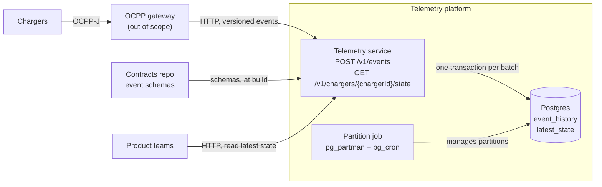
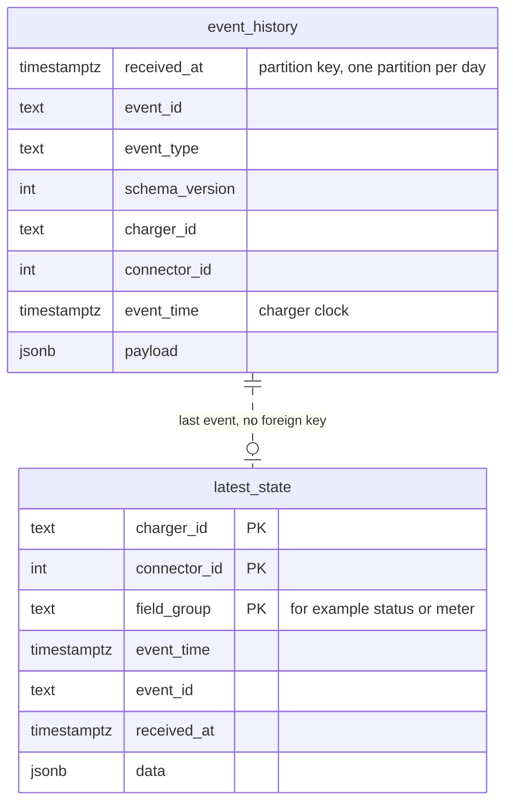

# Charger telemetry ingestion platform

## Summary

One service and one Postgres database ingest charger events and return the latest state of each charger. Latest state keeps one row for each group of fields (a field group), for example status or meter. An upsert writes a row only when the event is newer, so duplicates and out-of-order events are safe. Teams add event types and read latest state through a contracts repo and CI checks. After a one-time setup, they need no ticket to the Cloud team.

## 1. Architecture



### Event flow

1. The gateway sends a batch of events to `POST /v1/events`.
2. The service checks each event against the JSON Schema of its type and version. It lists the invalid events in the response. If no event is valid, it returns `400`.
3. The service writes the valid events in one transaction:
   - It inserts each event into `event_history`.
   - It upserts `latest_state` for each event. It writes only if the event is newer.
4. After the commit, the service returns `202`. If the database fails, it returns `503`, and the gateway sends the batch again.
5. `GET /v1/chargers/{chargerId}/state` reads all `latest_state` rows of the charger and returns them grouped by connector.

### Data model and storage

Each event has one versioned envelope: the `event_history` columns except `received_at`. The fields of the event type are in `payload`. Section 3 shows an example.



- `event_history` keeps each event as received. A `pg_partman` job, run by `pg_cron`, manages the daily partitions and drops partitions older than 30 days.
- `latest_state` keeps one row for each charger, connector, and field group. The fields are in `data`, so a new field or event type needs no migration.
- The contract of each event type names the field group that it updates.
- `connector_id = 0` is the charger itself.

### Duplicate and out-of-order events

The upsert keeps latest state correct:

```sql
INSERT INTO latest_state AS s (charger_id, connector_id, field_group, event_time, event_id, received_at, data)
VALUES ($1, $2, $3, $4, $5, $6, $7)
ON CONFLICT (charger_id, connector_id, field_group) DO UPDATE
SET event_time = EXCLUDED.event_time, event_id = EXCLUDED.event_id,
    received_at = EXCLUDED.received_at, data = EXCLUDED.data
WHERE (s.event_time, s.event_id) < (EXCLUDED.event_time, EXCLUDED.event_id);
```

- **Duplicates:** `event_id` is a hash of the event content (section 5), so a duplicate has the same `event_id` and `event_time`. A duplicate is not newer, so latest state ignores it.
- **Out of order:** A late event goes to history, but it does not replace a newer value in latest state. `event_id` breaks ties when two events have the same `event_time`.
- **One timestamp for each field group:** A late status event still updates status, even when a newer meter event exists.
- **History keeps duplicates:** In Postgres, a unique key on a partitioned table must include the partition key, `received_at`. A duplicate has a new `received_at`, so the key cannot find it. History is internal, so a read removes duplicates by `event_id`.

## 2. Platform and developer experience

The platform is a paved road: one contracts repo, CI checks in place of manual reviews, and one API to read latest state. The Cloud team owns the road. After a one-time setup, product teams use it without a ticket.

### Self-serve for a second team

**Add a new event type**

1. The team copies the template into its own folder in the contracts repo, and adds `v1.schema.json` and example events:

   ```yaml
   # contracts/diagnostics/firmware_status/contract.yaml
   event_type: firmware_status
   owner: diagnostics
   field_group: firmware
   ```

2. The team opens a PR. CI runs the checks (see "Safe by default").
3. The team approves its own PR. CODEOWNERS makes it the owner of its folder.
4. After the merge, CI builds the service with the new schema and deploys it with a canary (section 4).
5. The read API returns the new field group with no code change.

The gateway must also send the new type. The gateway is out of scope. Merge the contract first, and then change the gateway. Until then, the service rejects events of the new type, but it accepts the other events in the batch.

**Read latest state for the first time**

1. The team reads the OpenAPI spec. CI generates it from the contracts, so it always agrees with the data.
2. The team adds `consumers/<team>.yaml` with a client ID, a contact, and the field groups that it reads.
3. The team calls `GET /v1/chargers/{chargerId}/state` with the `X-Client-Id` header.

The client ID gives usage for each team. The consumer files show who reads each field group.

**What needs a review, and why**

| Change                                               | Review                            | Reason                                                                                                   |
| ---------------------------------------------------- | --------------------------------- | -------------------------------------------------------------------------------------------------------- |
| New event type or new optional field                 | None                              | CI checks it. It affects only the field groups of the team.                                              |
| New consumer                                         | None                              | A read does not change data.                                                                             |
| First PR of a new team                               | Cloud team, one time              | It adds the team folder and its CODEOWNERS line. A wrong line gives one team the folder of another team. |
| Breaking schema change                               | Consumer teams of the field group | Their code must change. CI finds them in `consumers/` and blocks the merge until they approve.           |
| Change to the envelope, the service, or the database | Cloud team                        | These changes affect all teams.                                                                          |

### Ownership: platform vs. product teams

| The Cloud team owns                                   | Product teams own                         |
| ----------------------------------------------------- | ----------------------------------------- |
| The telemetry service, the envelope, and the database | Their event schemas and contracts         |
| The upsert logic, the partitions, and the retention   | Their field groups                        |
| CI checks, templates, and docs                        | Their consumers and how they use the data |
| SLOs and on-call for ingest and read                  | Alerts on their own consumers             |

Tools hold the line, not people:

- **CODEOWNERS:** Each team owns `contracts/<team>/`. The Cloud team owns the envelope, the service code, the CI checks, and the CODEOWNERS file.
- **Branch protection:** No merge without green checks. Teams cannot change the checks.
- **No database access:** Teams use only the API. Thus, the Cloud team can change the database without breaking them.

### Safe by default

CI checks each contract PR, so no person must review it:

- The schema is valid, and the example events pass it.
- The new version is backward compatible with the old version, or the consumer teams approve it.
- No contract of another team names the same field group. One team cannot overwrite the state of another team.
- **Contract tests:** CI starts the service and Postgres, sends the example events of all teams, and checks the read API. CI blocks a change that breaks the examples of another team.

At runtime:

- The service rejects only the invalid events of a batch. Thus, one team cannot block the events of another team.
- Each deploy is a canary with automatic rollback (section 4).
- Rate limits for each team are out of scope (section 5).

### Adoption and feedback

To get teams to use it:

- **Make it the easiest path:** One template, one PR, and a guide "your first event in one hour".
- **Start with one pilot team:** Build the first event type together, and publish it as the example.
- **Be available:** One Slack channel and weekly office hours. The Cloud team pairs with each team on its first PR.
- **Guide AI agents too:** The Cloud team publishes an agent skill for the organization. The skill tells an AI coding agent how to add an event type or a consumer: the template, the folder rules, and the CI checks. The agent runs the checks locally before it opens the PR.

To know if it is good to build on:

| Metric                                                  | Target (example)    |
| ------------------------------------------------------- | ------------------- |
| Time from the first PR to the first event in production | Less than 1 day     |
| PRs merged without a Cloud team review                  | More than 80%       |
| Read API latency, p99 (read SLO)                        | Less than 100 ms    |
| Ingest success rate, no `5xx` (ingest SLO)              | More than 99.9%     |
| Support requests to the Cloud team for each new team    | Decreases over time |

## 3. Runnable slice

The slice in `slice/` runs the design of section 1: one service (Node.js, Fastify) and Postgres 16 in Docker Compose. It does not include the gateway, authentication, rate limits, or the CI checks of section 2.

```bash
# Run locally
cd slice
docker compose up --build -d

# Write an event
curl -s -X POST http://localhost:8080/v1/events \
  -H 'Content-Type: application/json' \
  -d '[{"event_id":"5f1d8c0e9a7b3c2d4e6f8a1b2c3d4e5f","event_type":"connector_status","schema_version":1,
        "charger_id":"CP-000123","connector_id":1,"event_time":"2026-11-01T18:26:00Z",
        "payload":{"status":"Charging","error_code":"NoError"}}]'
# {"accepted":1,"rejected":[]}

# Read latest state
curl -s http://localhost:8080/v1/chargers/CP-000123/state -H 'X-Client-Id: billing'
# {"charger_id":"CP-000123","connectors":{"1":{"status":{"event_time":"2026-11-01T18:26:00.000Z",
#   "event_id":"5f1d8c0e9a7b3c2d4e6f8a1b2c3d4e5f","data":{"status":"Charging","error_code":"NoError"}}}}}
```

`slice/demo.sh` runs the full flow: duplicates, out-of-order events, a batch with invalid events, and an unknown charger. `slice/README.md` has more detail.

## 4. Operations

### Deploy and rollback

CI deploys each merge to `main`.

1. CI runs the unit tests and the contract tests (section 2), and builds one image. The image tag is the Git commit SHA.
2. In each environment, CI runs the database migrations before the deploy. Each migration is backward compatible: it adds, but it does not rename or drop in the same release. Thus, the old and the new version can run at the same time.
3. CI deploys the image to staging and runs the contract tests there.
4. CodeDeploy deploys a canary to production: 10% of traffic for 10 minutes.
5. If the `5xx` rate or the p99 latency of the canary is above the ingest or read SLO (section 2), CodeDeploy rolls back automatically. If not, it sends all traffic to the new version.

A safe deploy here is small, automatic, backward compatible, and reversible in minutes.

**Rollback**

- **Service:** Deploy the previous image. The migrations are backward compatible, so the database needs no rollback.
- **Contract:** Revert the PR. CI builds and deploys again.
- **Wrong data in latest state:** Delete the affected rows, and send the events of the affected chargers again from `event_history`. The upsert keeps the newest event, so the order of the events is not important. Replay restores only rows with an event in the last 30 days.

### Infrastructure and secrets

- **Terraform** in the platform repo defines all infrastructure: the VPC, the ALB, RDS, ECS, and the CloudWatch alarms.
- CI runs `terraform plan` on each PR and `terraform apply` after the merge. No person changes infrastructure in the console. A plan each night finds drift.
- The service runs on ECS on Fargate, so there are no servers or clusters to manage.
- An internal ALB is in front of the service. It gives the gateway and the teams one stable endpoint, sends traffic only to tasks that pass `/healthz`, and has the two target groups that CodeDeploy needs for the canary.
- Postgres is Amazon RDS for PostgreSQL, with Multi-AZ, in a private subnet.
- **Secrets:**
  - The database password is in AWS Secrets Manager, with automatic rotation.
  - The service reads the password with its ECS task role.
  - No secrets in Git, in images, or in environment files. CI uses OIDC to get an IAM role, so it has no long-lived keys.

### Alerts

Page the on-call engineer:

- Ingest `5xx` rate above 0.1% for 5 minutes (ingest SLO).
- Ingest volume below 50% of the same hour last week. This finds a gateway or network failure that gives no errors.

Create a ticket:

- Events where `event_time` is more than 5 minutes after `received_at`. This finds a charger clock in the future.
- Fewer than 2 future partitions of `event_history`. This finds a failed partition job before writes fail.
- Rejected event rate above 1%. This finds a gateway that sends events before their contract exists.
- Read API p99 latency above 100 ms for 15 minutes (read SLO).
- Postgres storage or CPU above 80%.
- A canary rollback.

## 5. Trade-offs

### Assumptions and scope

**Assumptions**

- An OCPP gateway sends the events to the platform:
  - It terminates the OCPP connections to the chargers.
  - It converts the OCPP messages into one versioned event format.
  - It sets `event_time` from the charger timestamp.
  - It sets `event_id` to a hash of the event content: charger ID, connector ID, event type, `event_time`, and payload. Thus, a retry from the gateway and a resend from the charger get the same `event_id`.
  - It sends events in batches to `POST /v1/events`.
  - It sends a batch again after a `503` or a timeout. It does not send rejected events again.
- Some events arrive two times. Some events arrive out of order.
- Events flow in one direction: from the chargers to the platform.
- Events contain no personal data.
- Teams read only latest state. History is internal, for replay and audit.
- We keep history for 30 days.
- We deploy on AWS, in one region.
- Scale example: 100,000 chargers × 1 MeterValues message per minute ≈ 1,700 events/s on average. At 1 KB per event, history grows by approximately 145 GB per day. At 10x, we get 17,000 events/s. Peaks also occur when many chargers reconnect after an outage.

**Out of scope**

- The edge (OCPP connections to the chargers)
- Authentication of chargers and consumers.
- Backups and disaster recovery.
- Protection against charger clocks in the future. An event with a future `event_time` blocks its field group in latest state. An alert finds the charger (section 4), and a person resets the row.
- Rate limits for ingest and for consumers of the read API. One event type or one consumer can slow down Postgres for all teams.

### Cloud and portability

- **Portable:** The service is one container image. The data is in standard Postgres 16 with `pg_partman` and `pg_cron`. Google Cloud SQL and Azure Database for PostgreSQL also support these extensions. The contracts, the CI checks, and the API use no AWS service.
- **Lock-in:** ECS on Fargate, IAM, the OIDC trust for CI, Secrets Manager, CodeDeploy, and the Terraform modules for these services.
- **Cost of a move:** New Terraform modules and a new identity and secrets setup. The service code, the data model, and the contracts do not change.

### Options considered

- **A: AWS serverless** (Kinesis, Lambda, S3, DynamoDB). It needs little operations work, and it scales. It causes lock-in, and it is difficult to run locally.
- **B: Kafka + Postgres** (Kafka, a processor, history in S3, latest state in Postgres). It gives a buffer for peaks and outages, replay, and separate scaling. It is portable. Kafka has a high operations cost.
- **C: Postgres only.** It is the simplest option, and it is easy to run locally. The database is the bottleneck at 10x. Ingest stops when the database is slow or down.

At the example scale, the infrastructure cost is almost the same for all three: $1,400–3,500 each month (AWS list prices, without people). Cost is not a reason to select one option. Kafka needs the most operations time.

**Decision:** Option C, with history in Postgres.

- It is the simplest option that carries the example scale.
- The history insert and the latest-state upsert run in one transaction.
- It gives a clear path to B when traffic grows.

### What breaks first at 10x

At 10x, we get 17,000 events/s, 34,000 writes/s, and 1.45 TB of history each day. These parts break, in this order:

1. **History storage.** 30 days of history is approximately 55 TB with indexes. This is near the storage limit of managed Postgres (64 TiB on AWS RDS). Storage costs more than $10,000 each month.
2. **Write load on the primary.** One primary must do 34,000 writes/s. Autovacuum cannot keep up with the latest-state updates, and replicas fall behind.
3. **Peaks.** C has no buffer. After an outage, the API returns `503`, and the retries from the gateway add more load.

### What to build next

1. **Move old history to S3-compatible storage.** A daily job copies partitions older than 7 days to Parquet files and drops them. S3 keeps them until day 30. This fixes item 1.
2. **Add a stream (option B).** The ingest API writes to Kafka. A processor writes latest state to Postgres in batches, and a sink writes history to S3. This fixes items 2 and 3, and it gives replay.
3. **Shard latest state** by charger ID, or move it to a key-value store, if one primary is still not sufficient.
4. **Stream access for other teams.** Teams get their own consumer groups.
